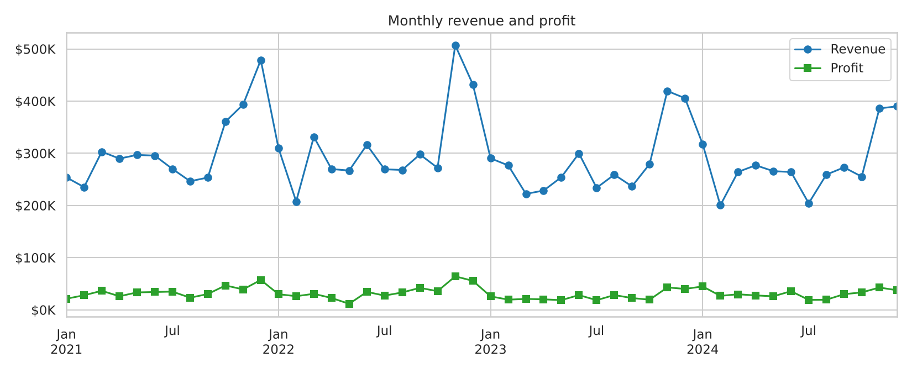
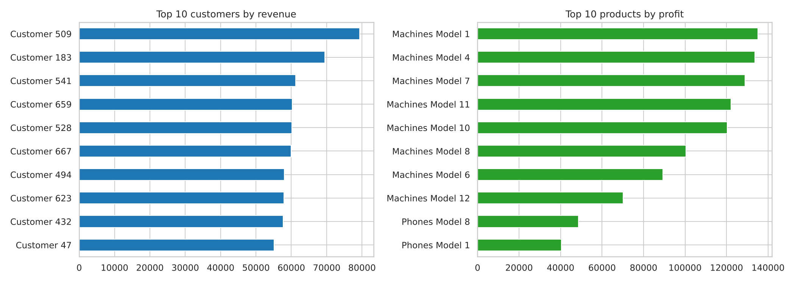
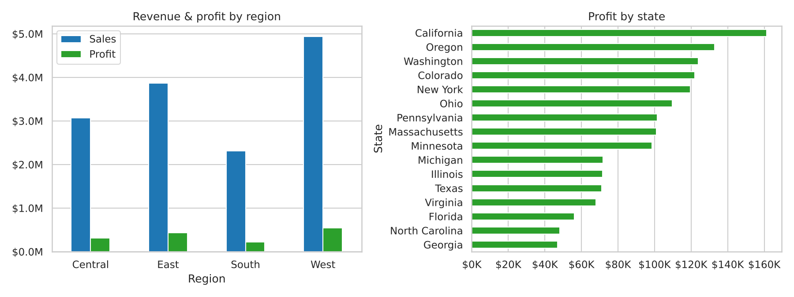
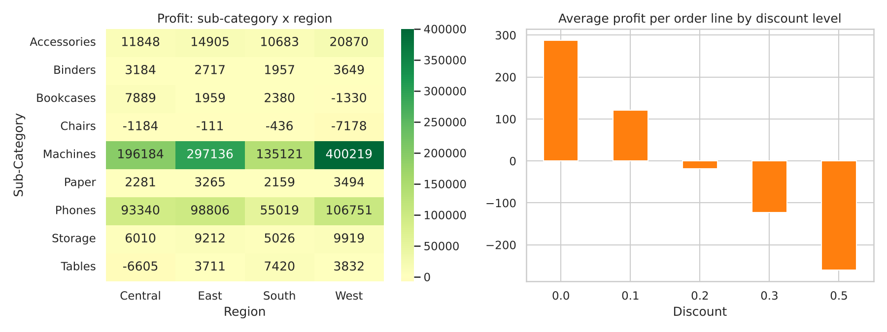

# Superstore Sales Performance Dashboard

**Level:** Intermediate  
> End-to-end sales analytics: Python, SQL, Excel and Power BI on the classic Superstore dataset.

> **Before you publish:** this repo ships with a *synthetic sample dataset* in the same format as the real one so everything runs out of the box. Download the real dataset (see below), put it at `data/superstore.csv`, re-run, and replace the Key Insights section with your real numbers. Then delete this note.

## Business questions

- What is monthly revenue?
- How is profit trending?
- Who are the top customers?
- Which products make the most profit?
- How do regions perform?

## Dataset

- Superstore Sales (Kaggle) - `Sample - Superstore.csv`
- Expected location: `data/superstore.csv` (search the dataset name on Kaggle to download it)
- If the file is missing, `generate_data.py` creates a sample with the same columns automatically.

## Skills demonstrated

Python (Pandas), SQL (SQLite: CTEs, window functions), Excel pivots, Power BI (KPIs, DAX, map, slicers)

## Project structure

```
README.md
analysis.ipynb         notebook (cells run top to bottom)
analysis.py            same analysis as a script
cleaned_dataset.csv
images/               charts used in this README
data/                 raw data goes here
generate_data.py      sample-data generator
requirements.txt
powerbi/              dashboard guide + export for Power BI
sql/queries.sql        SQL version of the analysis
```

## How to run

```bash
pip install -r requirements.txt
python analysis.py             # or: jupyter notebook analysis.ipynb
```

SQL: `python analysis.py` builds `superstore.db`; then run `sql/queries.sql`.
Power BI/Excel: see `powerbi/DASHBOARD_GUIDE.md` (KPIs: Revenue, Profit, Orders, Average Order Value; line, bar, map, slicers).

## Key insights

_Run the analysis and paste the five printed insights here, each with a recommendation. Example format:_

1. **Finding with a number** - e.g. "Month-to-month contracts churn at 3x the rate of two-year contracts."
   - *Recommendation:* what the business should do about it.
2. ...

## Visualizations






## Interview talking points

- Why heavy discounts (30%+) turn profitable lines into losses - and what pricing rule I would propose.
- How I computed AOV (revenue / distinct orders, not rows).

## Resume bullet (fill in your numbers)

> Built a sales dashboard (Python, SQL, Power BI) over [N]+ orders tracking Revenue, Profit, Orders and AOV; found that [X] discounts cut profit by [Y]%.

## Tech stack

Python, Pandas, NumPy, Matplotlib, Seaborn, Jupyter
